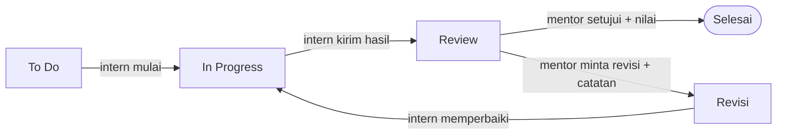

# PRD — Workspace Mentor & Intern

## Ringkasan

Simagang mendapat modul baru **Workspace**: ruang kerja online tempat mentor memberi tugas, memantau progres, dan berdiskusi dengan intern. Tugas yang selama ini diberikan secara lisan pindah ke web.

Modul ini terdiri dari tiga fitur:

1. **Workspace otomatis untuk intern baru**: tiap intern langsung dapat ruang khusus begitu akunnya aktif.
2. **Manajemen tugas ala Jira**: board kanban, deadline, review, dan revisi.
3. **Forum ala Slack**: channel per tim, thread, mention, dan lampiran.

**Kondisi sekarang.** Simagang (Laravel 12, Blade + Tailwind + Alpine.js, MySQL, Spatie Permission) sudah punya absensi, logbook (dengan komentar dan approval mentor), micro skill, laporan akhir, sharing session, dan sertifikat. Relasi mentor–intern sudah ada di `interns.mentor_id`, dan pembagian tim di `team_id`.

**Masalahnya:**

- Tugas diberikan secara lisan, jadi tidak ada jejak, deadline tidak tercatat, dan hasilnya sulit dinilai.
- Diskusi tersebar di WhatsApp pribadi atau grup dan tidak terarsip di sistem.
- Intern baru tidak punya tempat onboarding yang jelas.
- Admin tidak bisa memantau beban dan progres tugas per intern.

## Tujuan dan batasan

Targetnya: semua tugas dari mentor tercatat di web, dan intern baru langsung punya ruang kerja tanpa input manual dari admin.

**Tujuan**

1. Semua penugasan mentor ke intern dibuat, dikerjakan, dan direview lewat Simagang.
2. Intern baru otomatis masuk workspace tim dan mendapat space pribadi dengan mentornya.
3. Diskusi mentor–intern terarsip per tim dan per tugas.
4. Admin bisa memantau progres tugas per intern, mentor, dan tim.

**Tidak termasuk fase ini**

- Video call atau voice chat.
- Integrasi dengan Jira atau Slack asli. Fiturnya dibangun sendiri di dalam Simagang.
- Sprint, story point, dan burndown chart.
- Akses workspace untuk role Institusi dan Industri.
- Aplikasi mobile native. Cukup web yang responsif.

**Metrik keberhasilan (usulan, sesuaikan dengan pembimbing/atasan)**

| Metrik | Target | Cara ukur |
| --- | --- | --- |
| Intern aktif yang menerima ≥ 1 tugas via web per minggu | ≥ 80% | Query `tasks` + `task_assignees` per minggu |
| Tugas yang direview mentor ≤ 2 hari kerja setelah status Review | ≥ 70% | Selisih waktu di `task_activities` |
| Tugas selesai tepat waktu | Baseline di bulan pertama, lalu naik | `completed_at` ≤ `due_date` |
| Intern aktif yang membuka Workspace minimal 3 hari per minggu | ≥ 90% | Log akses / `channel_members.last_read_at` |
| Intern baru yang otomatis mendapat workspace | 100% | Intern aktif tanpa `workspace_members` = 0 |

## Pengguna dan hak akses

Modul ini dipakai tiga role yang sudah ada: Admin, Mentor, dan Intern. Role Institusi dan Industri belum mendapat akses di fase ini.

- **Admin** (`super_admin`, `admin_full`): mengelola workspace, template onboarding, dan memantau semua tim.
- **Mentor**: memberi dan mereview tugas, mengelola channel timnya, dan memoderasi diskusi.
- **Intern**: mengerjakan tugas, mengirim hasil, dan berdiskusi di channel tim serta space pribadinya.

| Aksi | Admin | Mentor | Intern |
| --- | --- | --- | --- |
| Melihat workspace | Semua tim | Tim sendiri + space intern bimbingan | Tim sendiri + space pribadi |
| Membuat / mengarsipkan workspace tim | ✓ | — | — |
| Membuat tugas dan meng-assign intern | ✓ | ✓ (intern bimbingan / satu tim) | Hanya tugas pribadi (to-do sendiri) |
| Memindahkan status sampai Review | ✓ | ✓ | ✓ (tugas yang di-assign ke dia) |
| Menandai Selesai atau Revisi | ✓ | ✓ | — |
| Menghapus tugas (soft delete) | ✓ | ✓ (tugas buatannya) | — |
| Mengelola template tugas onboarding | ✓ | ✓ (tim sendiri) | — |
| Membuat channel | ✓ | ✓ | — |
| Posting di #pengumuman | ✓ | ✓ | — |
| Mengirim pesan, membalas thread, mention | ✓ | ✓ | ✓ |
| Mengedit / menghapus pesan sendiri | ✓ | ✓ | ✓ |
| Menghapus pesan orang lain, pin pesan | ✓ | ✓ (channel timnya) | — |

Aturan akses ditulis sebagai Laravel Policy (`WorkspacePolicy`, `TaskPolicy`, `ChannelPolicy`) sehingga tidak bergantung pada prefix route per role.

## Fitur 1: Workspace otomatis untuk intern baru

Begitu intern aktif dan sudah punya mentor, sistem otomatis memasukkannya ke workspace timnya dan membuatkan space pribadi intern–mentor. Admin tidak perlu input apa pun.

**Dua jenis workspace**

| Jenis | Jumlah | Anggota | Isi |
| --- | --- | --- | --- |
| Workspace Tim | 1 per `teams` (bidang) | Semua mentor + intern aktif di tim itu | Board tugas tim, channel `#umum-<tim>`, channel topik |
| Space Intern (private) | 1 per intern | Intern + mentornya (admin bisa melihat) | Board tugas personal, channel DM intern–mentor |

**Pemicu.** Intern dibuat lewat `AdminInternController@store`, `IndustriInternController@store`, atau `AuthController` (register). Pemicu juga jalan saat data intern di-update dan kondisi `is_active = true` serta `mentor_id` terisi baru terpenuhi. Logikanya ditaruh di `InternObserver` (event `created` dan `updated`) yang memanggil service `WorkspaceProvisioner`. Service ini idempoten, jadi aman dipanggil berkali-kali.

**Yang dibuat otomatis**

1. Intern dimasukkan ke Workspace Tim dan channel `#umum-<tim>` serta `#pengumuman`.
2. Space Intern dibuat, dengan intern dan mentor sebagai anggota.
3. Pesan sambutan otomatis diposting di `#umum-<tim>`. Template pesannya bisa diedit admin di `system_settings`.
4. Tugas onboarding dibuat dari template tim, misalnya: lengkapi profil, baca panduan magang, perkenalan di channel tim, dan absen hari pertama.
5. Mentor mendapat notifikasi "Intern baru {nama} masuk tim {tim}".

**Kasus khusus**

- **Intern tanpa mentor** (misalnya dibuat role Industri, `mentor_id` kosong): pembuatan workspace ditunda. Intern melihat banner "Menunggu penetapan mentor", dan admin mendapat notifikasi.
- **Mentor diganti:** mentor lama dikeluarkan dari Space Intern dan mentor baru dimasukkan. Riwayat tugas dan chat tetap tersimpan.
- **Pindah tim:** keanggotaan Workspace Tim lama dicabut dan intern masuk ke tim baru. Tugas yang masih terbuka tetap ada di Space Intern.
- **Magang selesai** (`is_active = false` atau `end_date` lewat): akses intern menjadi read-only. Data diarsip, tidak dihapus.

**Kriteria penerimaan**

- [ ] Intern yang baru diaktifkan dan punya mentor langsung muncul di workspace tim dalam request yang sama.
- [ ] Menjalankan provisioning dua kali tidak membuat workspace, channel, atau tugas onboarding ganda.
- [ ] Intern tidak bisa membuka Space Intern milik intern lain (HTTP 403).
- [ ] Ada perintah `php artisan workspace:backfill` untuk membuatkan workspace bagi intern aktif yang sudah ada sebelum fitur rilis.

## Fitur 2: Manajemen tugas ala Jira

Mentor membuat tugas di board kanban dan meng-assign intern. Intern mengerjakan lalu mengirim hasil, dan mentor mereview sampai tugas dinyatakan Selesai.

Intern memindahkan tugas sampai Review; dari sana hanya mentor yang memutuskan Selesai atau Revisi, dan Revisi kembali ke In Progress.

**Atribut tugas**

| Field | Keterangan | Wajib |
| --- | --- | --- |
| Kode | Otomatis per workspace, misalnya `T-12`, bisa dirujuk di chat | Otomatis |
| Judul | Maks. 150 karakter | Ya |
| Deskripsi | Markdown sederhana (bold, list, link, code) | Tidak |
| Assignee | Satu atau lebih intern | Ya |
| Pembuat | Mentor/admin yang membuat | Otomatis |
| Prioritas | Rendah, Sedang, Tinggi, Urgent | Ya (default Sedang) |
| Status | To Do, In Progress, Review, Revisi, Selesai | Otomatis (default To Do) |
| Label | Tag bebas, misalnya `frontend`, `dokumen`, `desain` | Tidak |
| Tanggal mulai dan deadline | Tanggal + jam | Deadline wajib |
| Checklist | Sub-item yang bisa dicentang, progres dalam % | Tidak |
| Lampiran | PDF, DOC/DOCX, XLS/XLSX, PNG/JPG, ZIP, maks. 10 MB per file | Tidak |
| Link hasil | URL GitHub, Figma, Google Drive, dan lain-lain | Tidak |
| Feedback / nilai mentor | Catatan + nilai 0–100 saat Selesai | Tidak |

**Tampilan**

- **Board kanban**: kolom per status, kartu bisa di-drag & drop (SortableJS lewat cdn.jsdelivr.net, yang sudah diizinkan CSP).
- **List / tabel**: filter berdasarkan assignee, status, prioritas, label, dan rentang deadline.
- **Detail tugas**: deskripsi, checklist, lampiran, komentar, dan riwayat aktivitas (siapa mengubah apa, kapan).
- **Widget dashboard**: "Tugas Saya" di dashboard intern dan "Perlu Review" di dashboard mentor.
- **Admin**: rekap per tim, berisi jumlah tugas per status, tugas terlambat, dan mentor yang belum memberi tugas minggu ini.

**Aturan alur**

- Intern hanya bisa memindahkan tugas sampai **Review**.
- Hanya mentor/admin yang bisa menandai **Selesai** atau mengembalikan ke **Revisi**. Revisi wajib disertai catatan.
- Tugas yang melewati deadline dan belum Selesai otomatis diberi label **Terlambat** oleh scheduler harian (polanya sama dengan `MarkAlfaCommand`).
- Pengingat dikirim H-1 sebelum deadline.
- Mentor bisa menyimpan tugas sebagai **template** dan meng-assign-nya ke banyak intern sekaligus. Tiap intern mendapat salinan tugasnya sendiri.
- Logbook bisa ditautkan ke tugas (`logbooks.task_id` nullable), jadi aktivitas harian terhubung ke tugas yang dikerjakan.

**Kriteria penerimaan**

- [ ] Mentor bisa membuat tugas, meng-assign 1 atau lebih intern, dan intern menerima notifikasi.
- [ ] Intern yang mencoba menandai tugas Selesai lewat request langsung ditolak (HTTP 403).
- [ ] Setiap perubahan status tercatat di `task_activities`.
- [ ] Urutan kartu di board tetap sama setelah halaman di-refresh.
- [ ] Lampiran hanya bisa diunduh oleh anggota workspace.

## Fitur 3: Forum dan diskusi ala Slack

Diskusi mentor–intern pindah dari WhatsApp ke channel di Simagang, lengkap dengan thread, mention, dan lampiran, sehingga semuanya terarsip per tim.

**Jenis channel**

| Channel | Anggota | Dibuat oleh | Siapa bisa posting |
| --- | --- | --- | --- |
| `#pengumuman` (global) | Semua user aktif | Sistem | Admin, mentor |
| `#umum-<tim>` | Semua anggota tim | Sistem (otomatis) | Semua anggota |
| Channel topik, misalnya `#proyek-website` | Dipilih pembuat | Admin, mentor | Semua anggota |
| DM intern–mentor (di Space Intern) | Intern + mentornya | Sistem (otomatis) | Keduanya |

Diskusi khusus satu tugas memakai **komentar tugas** (Fitur 2), bukan channel.

**Fitur pesan**

- Teks dengan markdown sederhana dan emoji.
- Lampiran gambar atau dokumen, maks. 10 MB per file. Gambar dikompres dengan `intervention/image` yang sudah terpasang.
- Thread / balasan (`parent_id`), sehingga channel utama tetap rapi.
- Mention `@nama` (mengirim notifikasi) dan `@channel` (khusus mentor/admin).
- Rujukan tugas `#T-12` otomatis menjadi link ke detail tugas.
- Pin pesan penting di bagian atas channel.
- Edit pesan (diberi tanda "diedit") dan hapus (soft delete, tampil sebagai "pesan dihapus").
- Badge jumlah belum dibaca per channel, dihitung dari `last_read_message_id`.
- Pencarian pesan per channel.
- Reaksi emoji di fase 2.

**Mekanisme realtime**

- **MVP**: polling dengan Alpine.js `fetch` setiap 5–10 detik ke `GET /workspace/channels/{id}/messages?after={lastId}`. Polling hanya berjalan saat tab browser aktif. Cara ini tidak butuh server tambahan dan cocok dengan infrastruktur yang ada (`BROADCAST_DRIVER=log`).
- **Fase 2**: Laravel Reverb (websocket self-hosted) + Laravel Echo. CSP di `SecurityHeaders` perlu ditambah `connect-src` untuk `wss://`.

**Moderasi dan arsip**

- Mentor/admin bisa menghapus pesan dan mengarsipkan channel di timnya.
- Pesan tidak dihapus permanen selama periode magang berjalan, supaya ada jejak audit.

**Kriteria penerimaan**

- [ ] Pesan baru muncul di layar anggota lain dalam ≤ 10 detik (MVP polling).
- [ ] Intern tidak bisa membaca channel dari tim lain atau DM intern lain.
- [ ] Mention `@nama` memunculkan notifikasi di lonceng milik user yang di-mention.
- [ ] Badge belum dibaca hilang setelah channel dibuka.

## Notifikasi dan aktivitas

Notifikasi tampil di ikon lonceng (in-app) dengan Laravel Database Notifications. Email bersifat opsional. WhatsApp cukup lewat tombol link `wa.me`, sama seperti `PengajuanWhatsappService`.

| Event | Penerima | Kanal |
| --- | --- | --- |
| Intern baru masuk tim | Mentor, admin | In-app |
| Intern aktif tanpa mentor | Admin | In-app |
| Tugas baru di-assign | Intern | In-app + email |
| Tugas pindah ke Review | Mentor pembuat | In-app |
| Tugas Selesai atau Revisi | Intern | In-app + email |
| Deadline H-1 | Intern | In-app + email |
| Tugas terlambat | Intern, mentor | In-app |
| Komentar baru di tugas | Pembuat + assignee (kecuali penulis) | In-app |
| Mention di channel atau komentar | User yang di-mention | In-app |
| Pengumuman baru | Semua anggota | In-app |

**Detail teknis**

- Tambah tabel `notifications` (`php artisan notifications:table`).
- Ubah `QUEUE_CONNECTION` dari `sync` ke `database`, lalu jalankan worker `queue:work` lewat Supervisor atau PM2. Dengan begitu pengiriman email tidak memperlambat request.
- Cron `schedule:run` setiap menit untuk pengingat deadline dan penanda terlambat.
- Lonceng memakai polling yang sama dengan chat (satu endpoint ringkas: jumlah belum dibaca + 10 notifikasi terbaru).
- **Feed aktivitas** per workspace diambil dari `task_activities`, misalnya "Mentor A memindahkan T-12 ke Revisi".
- Fase 2: user bisa mematikan email per jenis notifikasi.

## Model data

Modul ini butuh 16 tabel baru (termasuk `notifications`) dan 1 kolom tambahan di `logbooks`. Penulis pesan, komentar, dan pembuat tugas memakai `users.id` karena admin, mentor, dan intern semuanya user. Assignee memakai `interns.id` supaya rekapnya nyambung dengan absensi, logbook, dan laporan.

| Tabel | Kolom utama | Relasi / catatan |
| --- | --- | --- |
| `workspaces` | id, type (`team`/`intern`), team_id?, intern_id?, name, slug, is_archived, created_by | Unique (type, team_id) dan (type, intern_id) |
| `workspace_members` | workspace_id, user_id, role (`owner`/`mentor`/`member`/`viewer`), joined_at, left_at? | Unique (workspace_id, user_id) |
| `tasks` | id, workspace_id, number, title, description, status, priority, created_by, start_at?, due_at, completed_at?, position, score?, feedback?, template_id?, deleted_at | Index (workspace_id, status, position) |
| `task_assignees` | task_id, intern_id | Unique (task_id, intern_id) |
| `task_checklist_items` | task_id, content, is_done, position | — |
| `task_labels` + `task_label` | id, team_id, name, color / task_id, label_id | Label per tim |
| `task_comments` | task_id, user_id, body, deleted_at | — |
| `task_activities` | task_id, user_id, action, meta (json), created_at | Log perubahan, untuk feed aktivitas dan metrik |
| `task_templates` | team_id, created_by, title, description, checklist (json), is_onboarding | Dipakai untuk onboarding dan assign massal |
| `channels` | id, workspace_id? (null = global), name, type (`announcement`/`team`/`topic`/`direct`), is_private, is_archived, created_by | — |
| `channel_members` | channel_id, user_id, last_read_message_id?, is_muted | Unique (channel_id, user_id) |
| `messages` | id, channel_id, user_id, parent_id?, body, is_pinned, edited_at?, deleted_at | Index (channel_id, id) untuk polling |
| `message_mentions` | message_id, user_id | Untuk notifikasi mention |
| `attachments` | attachable_type, attachable_id, user_id, disk, path, original_name, mime, size | Polymorphic: dipakai tasks, task_comments, messages |
| `notifications` | Standar Laravel | `php artisan notifications:table` |
| `logbooks` (ubah) | + task_id? | FK nullable ke `tasks` |

Status dan prioritas disimpan sebagai string dengan validasi di PHP Enum (`TaskStatus`, `TaskPriority`), bukan enum MySQL. Dengan begitu menambah status baru tidak perlu migration `ALTER`.

## Route, halaman, dan integrasi

Semua fitur ada di satu prefix bersama `/workspace` dengan middleware `auth`, dipakai bersama oleh admin, mentor, dan intern. Pembatasan aksesnya ditangani Policy, bukan dengan menduplikasi route di setiap grup role.

**Controller baru** (namespace `App\Http\Controllers\Workspace`): `WorkspaceController`, `TaskController`, `TaskCommentController`, `TaskTemplateController`, `ChannelController`, `MessageController`, `AttachmentController`, `NotificationController`. Logika provisioning ada di `App\Services\WorkspaceProvisioner`, dan pemicunya di `App\Observers\InternObserver`.

| Method | URI | Fungsi |
| --- | --- | --- |
| GET | `/workspace` | Daftar workspace user (tim + space intern) |
| GET | `/workspace/{workspace}` | Halaman utama workspace (tab Board, List, Channel, Aktivitas) |
| GET | `/workspace/{workspace}/tasks` | Board / list tugas (JSON untuk filter) |
| POST | `/workspace/{workspace}/tasks` | Buat tugas (bisa assign massal dari template) |
| GET | `/workspace/tasks/{task}` | Detail tugas |
| PUT | `/workspace/tasks/{task}` | Ubah tugas |
| PATCH | `/workspace/tasks/{task}/status` | Ubah status + posisi (drag & drop) |
| PATCH | `/workspace/tasks/{task}/review` | Mentor: Selesai / Revisi + feedback + nilai |
| DELETE | `/workspace/tasks/{task}` | Soft delete |
| POST | `/workspace/tasks/{task}/comments` | Tambah komentar |
| GET | `/workspace/channels/{channel}/messages` | Ambil pesan (`?after=` untuk polling, `?before=` untuk scroll ke atas) |
| POST | `/workspace/channels/{channel}/messages` | Kirim pesan / balas thread |
| PATCH / DELETE | `/workspace/messages/{message}` | Edit / hapus pesan |
| POST | `/workspace/channels/{channel}/read` | Tandai channel sudah dibaca |
| GET | `/workspace/attachments/{attachment}` | Unduh lampiran (dicek Policy, file di storage private) |
| GET | `/notifications` | Daftar notifikasi + jumlah belum dibaca |
| POST | `/notifications/read-all` | Tandai semua notifikasi sudah dibaca |
| GET / POST | `/admin/workspace/templates` | Admin: kelola template tugas onboarding |

**Perubahan di halaman yang sudah ada**

- `layouts/app.blade.php`: tambah menu **Workspace** di sidebar mentor dan intern (versi desktop dan mobile), serta ikon lonceng notifikasi di header.
- Dashboard intern: widget "Tugas Saya" (5 tugas terdekat deadline-nya) dan "Pesan belum dibaca".
- Dashboard mentor: widget "Perlu Review" dan "Tugas Terlambat" per intern.
- Admin → Monitoring: tambah kolom progres tugas (selesai / total, jumlah terlambat) per intern.
- Form logbook intern: dropdown opsional "Tugas terkait".
- Halaman detail intern (admin dan mentor): tab "Tugas".
- Fase 2: rekap tugas selesai bisa dilampirkan ke laporan akhir (`final_reports`).

## Non-fungsional, risiko, dan tahapan rilis

Rilis dibagi tiga fase. MVP fokus pada workspace otomatis, board tugas, dan channel berbasis polling. Realtime dan fitur tambahan masuk fase berikutnya.

**Kebutuhan non-fungsional**

- **Keamanan**: setiap aksi dicek Policy. Lampiran disimpan di storage private dan diunduh lewat route terautentikasi (polanya sama dengan `SecureDownloadController`). MIME dan ukuran file divalidasi. Markdown di-escape untuk mencegah XSS.
- **Rate limit**: kirim pesan maks. 30 per menit per user, dan upload maks. 10 file per menit.
- **Performa**: pesan di-load 50 per halaman, board dibatasi 200 tugas aktif per workspace, dan endpoint polling < 200 ms.
- **Responsif**: semua halaman bisa dipakai di layar HP (Tailwind), karena intern banyak memakai HP.
- **Audit**: perubahan tugas tercatat di `task_activities`, dan pesan dihapus secara soft delete.
- **Retensi**: workspace intern yang sudah selesai magang diarsip (read-only), tidak dihapus.

**Risiko**

| Risiko | Dampak | Mitigasi |
| --- | --- | --- |
| Mentor tetap memberi tugas secara lisan | Fitur jarang dipakai | Dashboard admin menampilkan mentor tanpa tugas minggu ini; sosialisasi + panduan singkat |
| Polling membebani VPS | Server lambat | Polling hanya saat tab aktif, interval adaptif (5 → 30 detik saat idle), index `(channel_id, id)`; Reverb di fase 2 |
| Lampiran memenuhi disk | Upload gagal | Batas 10 MB per file, kompresi gambar, kuota per workspace |
| Intern dari role Industri belum punya mentor | Workspace tertunda | Banner untuk intern + notifikasi ke admin |
| Queue masih `sync` | Request lambat saat kirim email | Pindah ke queue `database` + worker |

**Tahapan rilis**

| Fase | Cakupan | Syarat lanjut ke fase berikutnya |
| --- | --- | --- |
| 1. MVP | Workspace tim + Space Intern otomatis, backfill intern lama, board + list tugas, review/revisi, komentar, lampiran, channel tim + DM + pengumuman (polling), notifikasi in-app | Uji coba di 1 tim selama 2 minggu, tidak ada bug blocker |
| 2. Lanjutan | Template + assign massal, label, pengingat deadline via email, widget dashboard, kolom progres di Monitoring, tautan logbook–tugas, thread, pin, pencarian | Dipakai semua tim; metrik adopsi ≥ 80% |
| 3. Penyempurnaan | Laravel Reverb (realtime), reaksi emoji, pengaturan notifikasi per user, rekap tugas ke laporan akhir, nilai tugas sebagai masukan sertifikat | — |

**Pertanyaan terbuka**

- Apakah intern boleh melihat channel tim lain (read-only)?
- Apakah role Industri perlu akses workspace untuk intern yang ditempatkan di sana?
- Apakah VPS produksi bisa menjalankan proses websocket (Reverb) dan queue worker?
- Apakah nilai per tugas perlu masuk ke perhitungan sertifikat atau laporan akhir?
- Berapa lama arsip chat disimpan setelah magang selesai?

